# Vybora — Screen Navigation Map
**Phase 0 · Generated: 2026-11-19**
**Auditor: Antigravity (Senior Android / Compose Architect)**

---

## 1. Navigation Architecture Overview

```
MainActivity
└── WePlayTheme
    ├── AuthScreen            ← shown when ProfileStore.load() == null
    └── WePlayApp             ← shown when profile exists
        ├── Scaffold
        │   └── WePlayBottomBar  ← visible only when route ∈ Routes.tabs
        └── NavHost (startDestination = Routes.HUB)
            ├── Tab destinations (bottom bar shown)
            │   ├── HUB      → GameLobbyScreen
            │   ├── ROOM     → VoiceRoomListScreen
            │   ├── MSG      → MessagesScreen
            │   ├── DISCOVER → DiscoverScreen
            │   └── ME       → MeScreen
            └── Full-screen destinations (bottom bar hidden)
                ├── ROOM_DETAIL     → LiveVoiceRoomScreen
                ├── CHAT            → ChatScreen
                ├── USER            → UserProfileScreen
                ├── USER_DETAIL     → UserProfileDetailScreen
                ├── RANKING         → RankingScreen
                ├── ME_SETTINGS     → MeSettingsScreen
                ├── CREATE_ROOM     → CreateVoiceRoomScreen
                ├── LUDO            → LudoScreen
                ├── SPY             → SpyScreen
                ├── PROFILE_EDIT    → ProfileEditScreen
                ├── GIFTS           → GiftsScreen
                ├── FAMILY          → FamilyScreen
                ├── BACKPACK        → BackpackScreen
                ├── TOPUP           → TopUpScreen
                ├── SETTINGS        → SettingsHomeScreen
                ├── ACCOUNT_SETTINGS → AccountSettingsScreen
                ├── PRIVACY_SETTINGS → PrivacySettingsScreen
                ├── BLOCKED_USERS   → BlockedUsersScreen
                ├── REPORT_HISTORY  → ReportHistoryScreen
                ├── NOTIFICATION_SETTINGS → NotificationSettingsScreen
                ├── DND_SCHEDULE    → DndScheduleScreen
                ├── VOICE_SETTINGS  → VoiceSettingsScreen
                ├── GENERAL_SETTINGS → GeneralSettingsScreen
                ├── WALLET_SETTINGS → WalletSettingsScreen
                ├── WALLET_TRANSACTIONS → TransactionsScreen
                ├── PAYMENT_METHODS → PaymentMethodsScreen
                ├── HOST_EARNINGS   → HostEarningsScreen
                ├── SUPPORT_SETTINGS → SupportSettingsScreen
                └── ABOUT           → AboutScreen
```

**Back-stack strategy:** `popUpTo(startDestination) { saveState = true }` + `restoreState = true` on tab switches (standard Compose NavHost pattern). ✅  
**Deeplinks:** None configured.  
**Route typos / duplicates:** None found.

---

## 2. Full Routes Object Reference

| Constant | Route String | Screen Class |
|---|---|---|
| `HUB` | `tab_hub` | `GameLobbyScreen` |
| `ROOM` | `tab_room` | `VoiceRoomListScreen` |
| `DISCOVER` | `tab_discover` | `DiscoverScreen` |
| `MSG` | `tab_msg` | `MessagesScreen` |
| `ME` | `tab_me` | `MeScreen` |
| `ROOM_DETAIL` | `room/{roomId}` | `LiveVoiceRoomScreen` |
| `LUDO` | `game/ludo` | `LudoScreen` |
| `SPY` | `game/spy` | `SpyScreen` |
| `PROFILE_EDIT` | `profile/edit` | `ProfileEditScreen` |
| `GIFTS` | `profile/gifts` | `GiftsScreen` |
| `FAMILY` | `profile/family` | `FamilyScreen` |
| `BACKPACK` | `profile/backpack` | `BackpackScreen` |
| `SETTINGS` | `profile/settings` | `SettingsHomeScreen` |
| `ABOUT` | `profile/about` | `AboutScreen` |
| `ACCOUNT_SETTINGS` | `settings/account` | `AccountSettingsScreen` |
| `PRIVACY_SETTINGS` | `settings/privacy` | `PrivacySettingsScreen` |
| `BLOCKED_USERS` | `settings/privacy/blocked` | `BlockedUsersScreen` |
| `REPORT_HISTORY` | `settings/privacy/reports` | `ReportHistoryScreen` |
| `NOTIFICATION_SETTINGS` | `settings/notifications` | `NotificationSettingsScreen` |
| `DND_SCHEDULE` | `settings/notifications/dnd` | `DndScheduleScreen` |
| `VOICE_SETTINGS` | `settings/voice` | `VoiceSettingsScreen` |
| `GENERAL_SETTINGS` | `settings/general` | `GeneralSettingsScreen` |
| `WALLET_SETTINGS` | `settings/wallet` | `WalletSettingsScreen` |
| `WALLET_TRANSACTIONS` | `settings/wallet/transactions` | `TransactionsScreen` |
| `PAYMENT_METHODS` | `settings/wallet/payment-methods` | `PaymentMethodsScreen` |
| `HOST_EARNINGS` | `settings/wallet/host-earnings` | `HostEarningsScreen` |
| `SUPPORT_SETTINGS` | `settings/support` | `SupportSettingsScreen` |
| `TOPUP` | `profile/topup` | `TopUpScreen` |
| `CHAT` | `chat/{userId}` | `ChatScreen` |
| `USER` | `user/{userId}` | `UserProfileScreen` |
| `USER_DETAIL` | `profile/detail/{userId}` | `UserProfileDetailScreen` |
| `RANKING` | `tab_ranking` | `RankingScreen` |
| `ME_SETTINGS` | `tab_me_settings` | `MeSettingsScreen` |
| `CREATE_ROOM` | `tab_create_room` | `CreateVoiceRoomScreen` |

**Tab set:** `{HUB, ROOM, DISCOVER, MSG, ME}`

---

## 3. Per-Screen Reachable Destinations

### AuthScreen
- **Entry point:** App launch when no stored profile
- **Outbound:** Completes → `WePlayApp` (HUB tab)
- **Back:** N/A — no nav controller provided to AuthScreen

---

### GameLobbyScreen (`HUB`)
- **Entry point:** Bottom bar → HUB
- **Outbound (confirmed wired):**
  - Ludo card → `Routes.LUDO`
  - Spy card → `Routes.SPY`
  - Create Room button → `Routes.CREATE_ROOM` *(if wired)*
- **Outbound (not yet wired):**
  - Other game cards → game-specific routes (not built)
  - Explore post card → `Routes.USER` or `Routes.ROOM_DETAIL`
- **Back:** Bottom bar switch only (no back button)

---

### VoiceRoomListScreen (`ROOM`)
- **Entry point:** Bottom bar → ROOM
- **Outbound:**
  - Room card tap → `Routes.ROOM_DETAIL` with `roomId`
  - Create Room button → `Routes.CREATE_ROOM`
- **Back:** Bottom bar switch only

---

### LiveVoiceRoomScreen (`ROOM_DETAIL`)
- **Entry point:** `VoiceRoomListScreen` → room card
- **Outbound:**
  - Back / leave → pops back to `VoiceRoomListScreen`
  - Gift button → *(BROKEN — should open GiftTray)*
  - Seat tap → *(BROKEN — should open SeatActionSheet)*
  - Settings → *(BROKEN — should open RoomSettingsSheet)*
- **Receives:** `roomId: String` argument

---

### DiscoverScreen (`DISCOVER`)
- **Entry point:** Bottom bar → DISCOVER
- **Outbound (not wired):**
  - Trending card → `Routes.ROOM_DETAIL`
  - Event card → *(Event detail screen not built)*
  - Explore post → `Routes.USER`
- **Back:** Bottom bar switch only

---

### MessagesScreen (`MSG`)
- **Entry point:** Bottom bar → MSG
- **Outbound:**
  - Conversation row tap → `Routes.CHAT` with `userId`
- **Back:** Bottom bar switch only

---

### ChatScreen (`CHAT`)
- **Entry point:** `MessagesScreen` → conversation row
- **Outbound:**
  - Tap user avatar/name → `Routes.USER` with `userId`
  - Back → pops to `MessagesScreen`
- **Receives:** `userId: String` argument

---

### MeScreen (`ME`)
- **Entry point:** Bottom bar → ME
- **Outbound:**
  - Edit Profile → `Routes.PROFILE_EDIT`
  - Settings gear → `Routes.SETTINGS`
  - Ranking → `Routes.RANKING`
  - Top Up → `Routes.TOPUP`
  - Gifts → `Routes.GIFTS`
  - Backpack → `Routes.BACKPACK`
  - Family → `Routes.FAMILY`
  - Me Settings → `Routes.ME_SETTINGS`
  - Logout → pops back to `AuthScreen` (profile cleared)
  - Notification bell → *(BROKEN — notification center not built)*
- **Back:** Bottom bar switch only

---

### UserProfileScreen (`USER`)
- **Entry point:** Any screen → `Routes.USER` with `userId`
- **Outbound:**
  - Chat button → `Routes.CHAT` with `userId`
  - User detail → `Routes.USER_DETAIL` with `userId`
  - Back → pops
- **Receives:** `userId: String` argument

---

### UserProfileDetailScreen (`USER_DETAIL`)
- **Entry point:** `UserProfileScreen` → detail button
- **Outbound:**
  - Back → pops
- **Receives:** `userId: String` argument

---

### RankingScreen (`RANKING`)
- **Entry point:** `MeScreen` → Ranking
- **Outbound:**
  - Leaderboard row tap → `Routes.USER` *(not wired)*
  - Back → pops
- **Back:** Standard back press

---

### MeSettingsScreen (`ME_SETTINGS`)
- **Entry point:** `MeScreen` → Me Settings
- **Outbound:**
  - Navigates to various settings sub-screens
  - Back → pops

---

### CreateVoiceRoomScreen (`CREATE_ROOM`)
- **Entry point:** `VoiceRoomListScreen` or `GameLobbyScreen` → Create Room
- **Outbound:**
  - Tap Create → *(BROKEN — should navigate to LiveVoiceRoomScreen with new roomId)*
  - Back → pops

---

### LudoScreen (`LUDO`)
- **Entry point:** `GameLobbyScreen` → Ludo card
- **Outbound:**
  - Back → pops to `GameLobbyScreen`

---

### SpyScreen (`SPY`)
- **Entry point:** `GameLobbyScreen` → Spy card
- **Outbound:**
  - Back → pops to `GameLobbyScreen`

---

### ProfileEditScreen (`PROFILE_EDIT`)
- **Entry point:** `MeScreen` → Edit Profile
- **Outbound:**
  - Save → pops back to `MeScreen`
  - Back → pops

---

### GiftsScreen (`GIFTS`)
- **Entry point:** `MeScreen` → Gifts
- **Outbound:**
  - Back → pops
  - Send gift → *(BROKEN — no animation overlay)*

---

### FamilyScreen (`FAMILY`)
- **Entry point:** `MeScreen` → Family
- **Outbound:**
  - Back → pops

---

### BackpackScreen (`BACKPACK`)
- **Entry point:** `MeScreen` → Backpack
- **Outbound:**
  - Back → pops

---

### TopUpScreen (`TOPUP`)
- **Entry point:** `MeScreen` → Top Up; `WalletSettingsScreen` → Top Up
- **Outbound:**
  - Back → pops

---

### SettingsHomeScreen (`SETTINGS`)
- **Entry point:** `MeScreen` → Settings
- **Outbound:**
  - Account Settings → `Routes.ACCOUNT_SETTINGS`
  - Privacy Settings → `Routes.PRIVACY_SETTINGS`
  - Notification Settings → `Routes.NOTIFICATION_SETTINGS`
  - Voice Settings → `Routes.VOICE_SETTINGS`
  - General Settings → `Routes.GENERAL_SETTINGS`
  - Wallet Settings → `Routes.WALLET_SETTINGS`
  - Support → `Routes.SUPPORT_SETTINGS`
  - About → `Routes.ABOUT`
  - Back → pops

---

### AccountSettingsScreen (`ACCOUNT_SETTINGS`)
- **Entry point:** `SettingsHomeScreen`
- **Outbound:** Logout → AuthScreen; Back → pops

---

### PrivacySettingsScreen (`PRIVACY_SETTINGS`)
- **Entry point:** `SettingsHomeScreen`
- **Outbound:**
  - Blocked Users → `Routes.BLOCKED_USERS`
  - Report History → `Routes.REPORT_HISTORY`
  - Back → pops

---

### BlockedUsersScreen (`BLOCKED_USERS`)
- **Entry point:** `PrivacySettingsScreen`
- **Outbound:** Back → pops

---

### ReportHistoryScreen (`REPORT_HISTORY`)
- **Entry point:** `PrivacySettingsScreen`
- **Outbound:** Back → pops

---

### NotificationSettingsScreen (`NOTIFICATION_SETTINGS`)
- **Entry point:** `SettingsHomeScreen`
- **Outbound:**
  - DND Schedule → `Routes.DND_SCHEDULE`
  - Back → pops

---

### DndScheduleScreen (`DND_SCHEDULE`)
- **Entry point:** `NotificationSettingsScreen`
- **Outbound:** Back → pops

---

### VoiceSettingsScreen (`VOICE_SETTINGS`)
- **Entry point:** `SettingsHomeScreen`
- **Outbound:** Back → pops

---

### GeneralSettingsScreen (`GENERAL_SETTINGS`)
- **Entry point:** `SettingsHomeScreen`
- **Outbound:** Back → pops

---

### WalletSettingsScreen (`WALLET_SETTINGS`)
- **Entry point:** `SettingsHomeScreen`
- **Outbound:**
  - Transactions → `Routes.WALLET_TRANSACTIONS`
  - Payment Methods → `Routes.PAYMENT_METHODS`
  - Host Earnings → `Routes.HOST_EARNINGS`
  - Top Up → `Routes.TOPUP`
  - Back → pops

---

### TransactionsScreen (`WALLET_TRANSACTIONS`)
- **Entry point:** `WalletSettingsScreen`
- **Outbound:** Back → pops

---

### PaymentMethodsScreen (`PAYMENT_METHODS`)
- **Entry point:** `WalletSettingsScreen`
- **Outbound:** Back → pops

---

### HostEarningsScreen (`HOST_EARNINGS`)
- **Entry point:** `WalletSettingsScreen`
- **Outbound:** Back → pops

---

### SupportSettingsScreen (`SUPPORT_SETTINGS`)
- **Entry point:** `SettingsHomeScreen`
- **Outbound:** Back → pops

---

### AboutScreen (`ABOUT`)
- **Entry point:** `SettingsHomeScreen`
- **Outbound:** Back → pops

---

## 4. Navigation Flow Diagram

```mermaid
flowchart TD
    Launch([App Launch]) --> Auth{Profile stored?}
    Auth -- No --> AuthScreen
    AuthScreen -- Save profile --> HUB

    Auth -- Yes --> HUB

    subgraph BottomBar["Bottom Bar Tabs"]
        HUB[GameLobbyScreen]
        ROOM[VoiceRoomListScreen]
        MSG[MessagesScreen]
        DISC[DiscoverScreen]
        ME[MeScreen]
    end

    HUB --> LUDO[LudoScreen]
    HUB --> SPY[SpyScreen]
    HUB --> CREATE[CreateVoiceRoomScreen]

    ROOM --> ROOM_DETAIL[LiveVoiceRoomScreen]
    ROOM --> CREATE

    MSG --> CHAT[ChatScreen]
    CHAT --> USER[UserProfileScreen]

    DISC -.-> ROOM_DETAIL
    DISC -.-> USER

    ME --> PROFILE_EDIT[ProfileEditScreen]
    ME --> RANKING[RankingScreen]
    ME --> TOPUP[TopUpScreen]
    ME --> GIFTS[GiftsScreen]
    ME --> BACKPACK[BackpackScreen]
    ME --> FAMILY[FamilyScreen]
    ME --> ME_SETTINGS[MeSettingsScreen]
    ME --> SETTINGS[SettingsHomeScreen]
    ME -- Logout --> AuthScreen

    SETTINGS --> ACCT[AccountSettingsScreen]
    SETTINGS --> PRIV[PrivacySettingsScreen]
    SETTINGS --> NOTIF[NotificationSettingsScreen]
    SETTINGS --> VOICE[VoiceSettingsScreen]
    SETTINGS --> GEN[GeneralSettingsScreen]
    SETTINGS --> WALLET[WalletSettingsScreen]
    SETTINGS --> SUPPORT[SupportSettingsScreen]
    SETTINGS --> ABOUT[AboutScreen]

    PRIV --> BLOCKED[BlockedUsersScreen]
    PRIV --> REPORTS[ReportHistoryScreen]
    NOTIF --> DND[DndScheduleScreen]
    WALLET --> TXN[TransactionsScreen]
    WALLET --> PAY[PaymentMethodsScreen]
    WALLET --> EARN[HostEarningsScreen]
    WALLET --> TOPUP

    USER --> USER_DETAIL[UserProfileDetailScreen]

    style ROOM_DETAIL fill:#ff9999
    style GIFTS fill:#ff9999
    style CREATE fill:#ff9999
    style DISC fill:#ffcc99
```



> [!NOTE]
> Red nodes have broken outbound actions. Orange nodes have unwired navigations.

---

## 5. Missing Destinations (No Screen Built)

| Intended Route | From Screen | Purpose |
|---|---|---|
| `notification/center` | `MeScreen` (bell icon) | Notification inbox |
| `event/detail/{id}` | `DiscoverScreen` | Event detail page |
| `family/create` | `FamilyScreen` | Create a new family |
| `family/discovery` | `FamilyScreen` | Browse families |
| `game/lobby/{gameId}` | `GameLobbyScreen` | Pre-join game lobby |
| `game/result` | `LudoScreen`, `SpyScreen` | Post-game rewards |
| `search` | Global (search icon) | Global search |
| `onboarding` | `AuthScreen` | Welcome flow |
| `splash` | App launch | Splash / branding screen |
